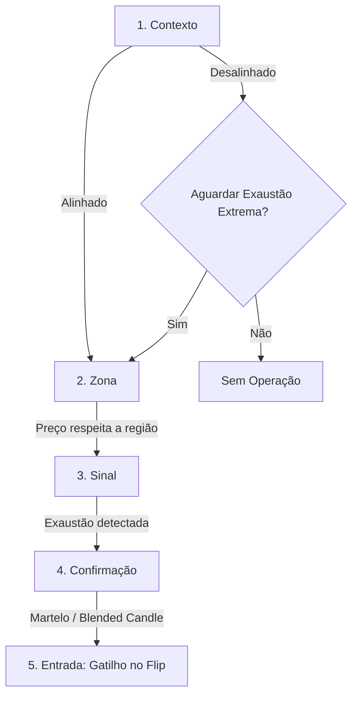
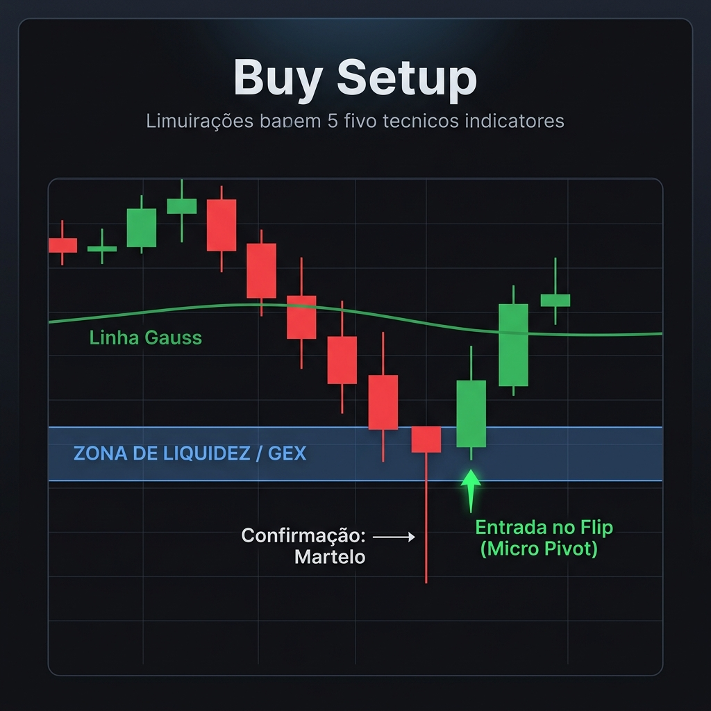

# Manual de Operação IRAI — Playbook Operacional

Este manual detalha o protocolo operacional de tomada de decisão do sistema IRAI. A execução deve seguir rigorosamente a sequência de validação em 5 etapas: **Contexto ➔ Zona ➔ Sinal ➔ Confirmação ➔ Entrada (Flip)**.

---

## Fluxo Operacional

---

## 1. Contexto (Tendência Macro e Micro)
O contexto determina a direção permitida para o dia ou para o movimento atual. É composto por dois indicadores principais:

*   **Rastro Macro**: Indica a direção de maior prazo (Compra ou Venda).
*   **Linha Gauss (Média/Tendência)**: A cor da linha define a tendência imediata do ativo (Verde para Compra, Vermelha para Venda).

### Regras de Validação do Contexto
1.  **Cenário Ideal (Alinhamento)**: O Rastro Macro e a Linha Gauss apontam para o mesmo lado (ambos Compra ou ambos Venda). Apenas operações nesta direção são permitidas.
2.  **Cenário Desalinhado**: Rastro Macro e Linha Gauss em sentidos opostos.
    *   *Regra de Segurança*: **Não operar** tendências indefinidas.
    *   *Exceção*: Operar contra a tendência imediata apenas se houver sinal claro de **Exaustão Extrema** do movimento na Zona de interesse.

---

## 2. Zona (Regiões de Interesse / Liquidez)
As zonas são faixas de preço no gráfico onde há alta probabilidade de interesse de grandes players e instituições. O preço deve chegar a essas regiões para que o trade seja cogitado.

### Zonas Identificadas (Mesma Prioridade/Peso)
*   **GEX (Gamma Exposure)**: Níveis de maior acúmulo de gama e potenciais suportes/resistências dinâmicos.
*   **Regiões de Liquidez Diária**:
    *   Ajuste do dia anterior.
    *   Máxima do dia anterior.
    *   Mínima do dia anterior.
*   **Pontos de Liquidez**: Marcações específicas plotadas no gráfico de fluxo e volume.

### Regra de Validação da Zona
*   **Respeito à Região**: A zona só é considerada válida se o preço reagir ao tocá-la, mostrando rejeição inicial (defesa dos players na faixa de preço).

---

## 3. Sinal (Gatilho de Exaustão)
O sinal aponta que o movimento de teste da zona atingiu uma saturação (exaustão), aumentando a probabilidade de reversão imediata.

### Fontes de Sinal (Basta uma delas ocorrer na Zona)
1.  **Banda Gauss**: Preço tocando ou ultrapassando os limites externos das bandas de desvio Gauss.
2.  **Z-Score do Pair Trading**: Desvio estatístico extremo do spread entre ativos correlacionados (ex: `WIN$N` vs `WDO$N`), indicando distorção pronta para correção.
3.  **Pullback na Média Gauss**: Reteste saudável e exaustão no toque de retorno à média da Linha Gauss após rompimento.

---

## 4. Confirmação (Leitura de Fluxo)
A confirmação é o sinal visual de que os compradores/vendedores defenderam a região e começaram a deslocar o preço na direção oposta ao movimento anterior.

### Padrões de Confirmação (Inversão de Fluxo no Candle)
*   **Martelo / Estrela Cadente**: Candle com pavio longo (pelo menos 2x o tamanho do corpo) indicando absorção e rejeição da zona de liquidez.
*   **Blended Candle**: Uma combinação de candles seguidos que, se somados (fundidos no tempo), formam a figura de um martelo/pavio de rejeição.

---

## 5. Entrada (Gatilho no Flip)
A entrada é o gatilho exato para posicionar a ordem no mercado. Não entramos no fechamento do candle de confirmação, mas sim no comportamento do candle seguinte.

### O Gatilho do Flip (Micro Pivot)
O **Flip** é um micro pivot configurado no candle de entrada:
1.  O novo candle abre e inicialmente **se move na direção contrária** à nossa operação pretendida (testando novamente a zona).
2.  Em seguida, o fluxo entra forte na direção correta, fazendo o candle **romper o seu próprio preço de abertura** (virar de cor).
3.  **Execução**: A entrada é disparada no momento exato em que a abertura é rompida de volta (o "flip" da cor).

*   *Exemplo na Compra*: Candle de confirmação fecha deixando pavio de rejeição na mínima anterior. O candle seguinte abre, cai um pouco em direção à mínima (fica vermelho), reverte pro movimento de alta e rompe a sua própria linha de abertura (vira verde). A compra é executada nesse rompimento da abertura.

---

## Exemplos Visuais de Operações

### 1. Operação de Compra (Buy Setup)
Abaixo está a representação visual de um setup completo de Compra (Buy Setup). O preço testa a zona de liquidez inferior (GEX/Ajuste), ativa o sinal de exaustão na banda inferior, forma um Martelo de confirmação e aciona a entrada no **Flip** (abertura contrária seguida de rompimento da abertura).

---

### 2. Operação de Venda (Sell Setup)
Abaixo está a representação visual de um setup completo de Venda (Sell Setup). O preço testa a zona de liquidez superior, ativa o sinal de exaustão na banda superior de Gauss, forma uma Estrela Cadente de confirmação e aciona a entrada no **Flip** de venda (candle seguinte abre subindo contra o trade, reverte e rompe a própria abertura para baixo).

---

## 6. Gestão de Risco Quantitativa (GARCH)
O controle de risco do sistema IRAI é baseado diretamente no desvio padrão diário projetado pelo modelo **GARCH** (`h+1`). Isso assegura um stop dinâmico e matematicamente alinhado com a volatilidade real do ativo operado.

### Regra do Stop por Operação
*   **Tamanho do Stop**: Ajustado para **10% a 12%** da volatilidade esperada diária (`h+1`).
*   *Lógica*: Protege a conta contra excesso de ruído em dias altamente voláteis e reduz financeiramente o stop em dias muito lentos.

### Regra do Limite Diário (Stop Total)
*   **Limite Total (Drawdown)**: Definido como **50% da volatilidade esperada (0.5σ GARCH)**.
*   *Lógica*: Equivale a exatamente **4 tentativas cheias** com stop de 12%, ou **5 tentativas** com stop de 10%. Atingir o limite de 50% do GARCH encerra as operações do dia, pois o mercado mudou de comportamento ou as condições do setup falharam.

### Exemplos Práticos de Cálculo

#### A. Mini Índice (WIN)
*   *Abertura*: $120.000$ pontos | *Projeção GARCH*: $1.07\%$
*   **Volatilidade Diária Estimada (1σ)**: $1.284 \text{ pontos}$.
*   **Stop por Trade (10% | 12%)**: $128 \text{ a } 154 \text{ pontos}$ ($R\$ 25,60 \text{ a } R\$ 30,80$ por mini-contrato).
*   **Limite de Perda do Dia (50% GARCH)**: $642 \text{ pontos}$ de prejuízo acumulado ($R\$ 128,40$ por mini-contrato).

#### B. Mini Dólar (WDO)
*   *Abertura*: $5.100$ pontos | *Projeção GARCH*: $0.85\%$
*   **Volatilidade Diária Estimada (1σ)**: $43,3 \text{ pontos}$.
*   **Stop por Trade (10% | 12%)**: $4,3 \text{ a } 5,2 \text{ pontos}$ ($R\$ 43,00 \text{ a } R\$ 52,00$ por mini-contrato).
*   **Limite de Perda do Dia (50% GARCH)**: $21,6 \text{ pontos}$ de prejuízo acumulado ($R\$ 216,00$ por mini-contrato).

#### C. Índices Americanos (S&P 500, Dow Jones, Nasdaq) & Ouro (XAUUSD)
*   *Regra de Medida*: No MetaTrader 5, esses ativos são mostrados em pontos com duas casas decimais. Multiplicamos a variação por **100** para expressar em pontos inteiros corretos de corretora (1 pt = 0.01 de preço).
*   *Exemplo Ouro*: Abertura: $2.400 | GARCH: 1.25%
    *   **Volatilidade Estimada (1σ)**: $3.000 \text{ pontos}$ ($30 \text{ dólares}$).
    *   **Stop por Trade (10% | 12%)**: $300 \text{ a } 360 \text{ pontos}$ ($3,00 \text{ a } 3,60 \text{ dólares}$).
    *   **Limite do Dia (50% GARCH)**: $1.500 \text{ pontos}$ ($15 \text{ dólares}$).

#### D. Forex Padrão (EURUSD, GBPUSD)
*   *Regra de Medida*: Medido em **Pips** (4ª casa decimal do preço: 0.0001). Variação multiplicada por **10.000**.
*   *Exemplo EURUSD*: Abertura: $1.0850 | GARCH: 0.45%
    *   **Volatilidade Estimada (1σ)**: $48,8 \text{ pips}$.
    *   **Stop por Trade (10% | 12%)**: $4,9 \text{ a } 5,9 \text{ pips}$.
    *   **Limite do Dia (50% GARCH)**: $24,4 \text{ pips}$.

#### E. Forex JPY (USDJPY)
*   *Regra de Medida*: Medido em **Pips JPY** (2ª casa decimal do preço: 0.01). Variação multiplicada por **100**.
*   *Exemplo USDJPY*: Abertura: $157.50 | GARCH: 0.65%
    *   **Volatilidade Estimada (1σ)**: $102,4 \text{ pips}$.
    *   **Stop por Trade (10% | 12%)**: $10,2 \text{ a } 12,3 \text{ pips}$.
    *   **Limite do Dia (50% GARCH)**: $51,2 \text{ pips}$.

---

## Checklist Rápido de Execução

- [ ] **Contexto Alinhado?** (Se não, aguardar exaustão extrema)
- [ ] **Preço em Zona de Relevância?** (GEX, Ajuste, Máxima, Mínima ou Liquidez)
- [ ] **Sinal de Exaustão Presente?** (Banda Gauss, Z-Score Pair ou Reteste)
- [ ] **Candle Confirmou Inversão de Fluxo?** (Martelo ou Blended Candle)
- [ ] **Candle Seguinte Realizou o Flip?** (Micro pivot rompendo a própria abertura)
