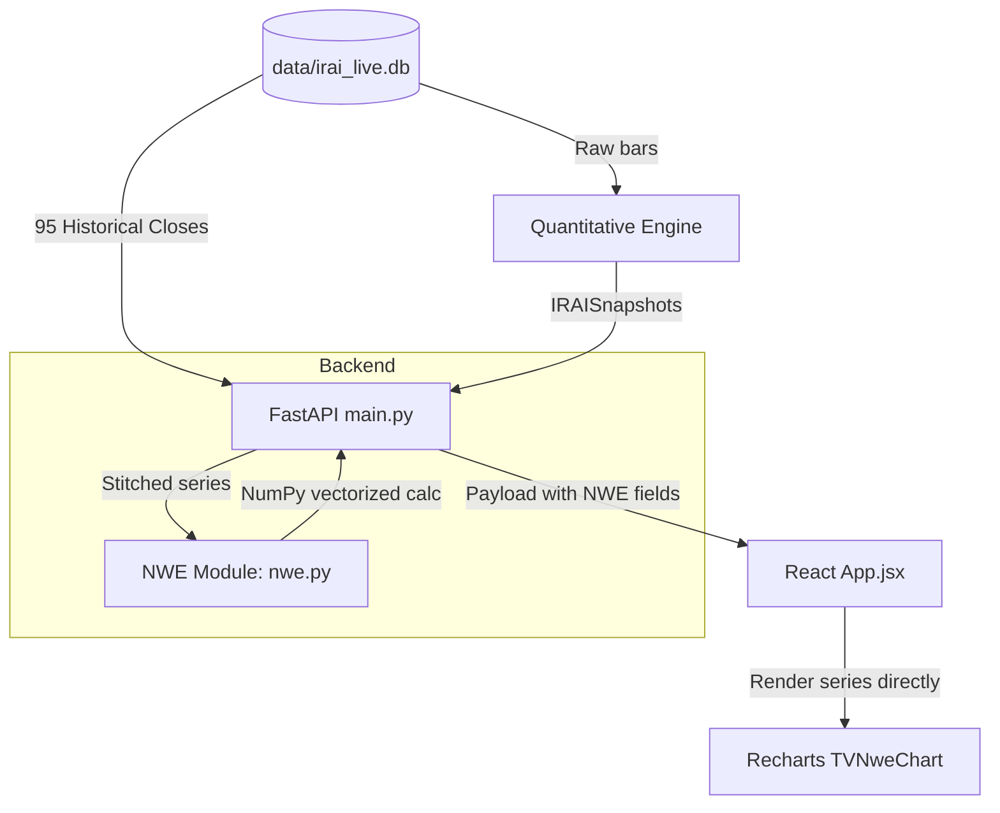

# Architecture Research

**Domain:** Nadaraya-Watson Envelope (NWE) Migration
**Researched:** 2026-07-13
**Confidence:** HIGH

## Component Layout & Data Flow

### Components

1. **`backend/quantitative/nwe.py` [NEW]**:
   - Uma nova biblioteca contendo a função utilitária `compute_nwe(data_list, history_closes)`.
   - Responsável por fazer a vetorização do kernel regression (Gaussian Kernel Causal) e do desvio MAE usando NumPy.
   
2. **`backend/api/main.py` [MODIFY]**:
   - Importa `compute_nwe`.
   - Na função `_get_series_data_sync`, após obter a lista de `snapshots` convertida em dicionários, chama `compute_nwe` passando a série e `history_closes`.
   - Anexa as chaves de NWE (`nwe_center`, `nwe_upper`, `nwe_lower`, `nwe_slope`, `nwe_up`, `nwe_down`, etc.) nos objetos de barra retornados sob a chave `"series"`.

3. **`frontend/src/App.jsx` & `frontend/src/components/TVNweChart.jsx` [MODIFY]**:
   - Removem a função redundante `computeNWE()`.
   - Consomem as propriedades `nwe_center`, `nwe_upper`, `nwe_lower`, `nwe_up` e `nwe_down` diretamente do payload de séries fornecido pela API.

## Data Integration & Formats

*   **API Response Payload (`/api/irai/series`)**:
    Cada objeto dentro da lista `"series"` receberá os seguintes campos numéricos/nulos adicionais:
    - `nwe_center`: float (%)
    - `nwe_upper`: float (%)
    - `nwe_lower`: float (%)
    - `nwe_center_price`: float (preço absoluto)
    - `nwe_upper_price`: float (preço absoluto)
    - `nwe_lower_price`: float (preço absoluto)
    - `nwe_slope`: float (diferença absoluta do centro)
    - `nwe_up`: float (%) ou null
    - `nwe_down`: float (%) ou null
    - `nwe_up_price`: float ou null
    - `nwe_down_price`: float ou null
