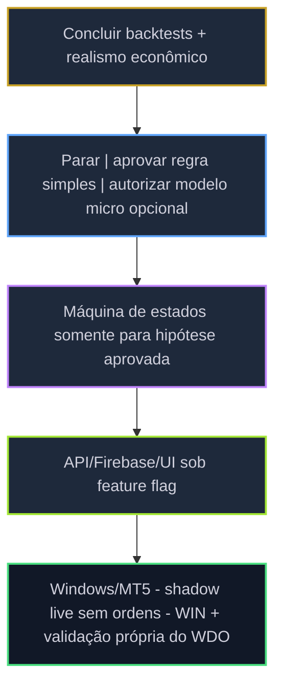

# IRAI — Visão de Negócio do Projeto

## De onde surgiu

A ideia do Miqueias foi evoluir o IRAI de um painel de contexto cross-asset para uma ferramenta capaz de reconhecer oportunidades táticas em WIN e WDO. Os markers visuais `P COMPRA/VENDA` e `Z COMPRA/VENDA` pareciam possíveis entradas, mas a auditoria mostrou que eles representam **distorções**, não setups validados. Isso originou o processo atual: corrigir a base causal, medir valor econômico e só então construir estados operacionais.

---

## O que o sistema combina

| Camada | Papel de negócio |
| :--- | :--- |
| **IRAI / P_up / fatores globais** | Contexto macro e regime da sessão; não é entrada curta por si só. |
| **Pair Z-Score e divergência macro-preço** | Identificam afastamentos do preço em relação ao par ativo e ao contexto macro. |
| **Gauss (NWE) e abertura** | Formam o mapa intraday de tendência, pullback, exaustão e regiões de reação. |
| **GEX: Gamma Max/Min/Flip, walls e mid-walls** | Forma o mapa estrutural vindo das opções; é região de suporte/resistência candidata, não sinal automático. |
| **Qualidade dos dados** | Barra fechada, stale, ghost, pré-mercado, volume, horário e rollover decidem se a leitura é utilizável. |

> [!NOTE]
> Os badges atuais `D-P-Z-E` são leituras derivadas e correlacionadas, não quatro votos independentes. Existe ainda uma colisão de nomes: `P` significa *Pullback Gauss* nesse painel e *Pair Signal* nos markers novos; a nomenclatura deve ser separada antes do Tactical.

---

## Regras de negócio

1. **Marker é observação;** não é entrada nem confirmação.
2. **Nenhum estado operacional** ou evento nasce de candle ainda aberto.
3. **Backtest e live** usam a mesma regra, timestamps e primeiro preço realmente negociável.
4. **Custos, rollover, horário** e qualidade dos dados fazem parte do resultado.
5. **GEX só pode usar** informação disponível antes da decisão, específica do ativo e ainda válida; tocar uma wall não confirma operação automaticamente.
6. **Evidências correlacionadas** não são somadas como votos independentes.
7. **IRAI e GEX** devem provar valor incremental como filtros ou regiões, comparando a mesma regra com e sem cada componente.
8. **Regra simples vence** modelo complexo quando entrega resultado equivalente.
9. **Nenhuma hipótese** chega a `CONFIRMADO` sem resultado fora da amostra, líquido de custos e superior a baselines simples.
10. **`NÃO_OPERAR` é uma decisão válida;** aprovação também pode ser revogada por drift ou degradação live.

---

## Onde estamos

A fundação causal já foi concluída: horários/DST, lookahead, NWE/Gauss, migrações, thresholds e barra fechada foram corrigidos ou centralizados. O GEX já funciona de ponta a ponta para WIN e WDO no dashboard, mas ainda não foi validado economicamente dentro da regra tática.

Os primeiros backtests mostram Pair sem edge no WIN e adverso no WDO; a divergência z é rara, inconclusiva no WIN e também adversa no WDO. Combinações com regime IRAI, Gauss, abertura e GEX ainda precisam provar valor.

---

## Para onde vamos

No futuro, um EA poderá consumir eventos aprovados, mas execução, lote, risco e ordens serão uma camada separada. O resultado buscado é uma plataforma causal, auditável e explicável que separa **contexto, distorção, região, confirmação e execução**, sem transformar um indicador visualmente atraente em operação antes de existir evidência.
