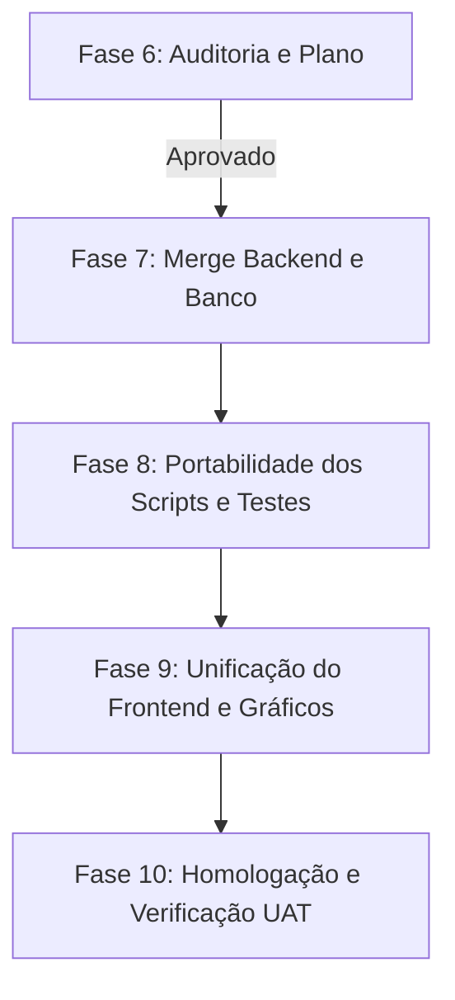

# Comparação Detalhada: Local (main) vs. Fork (brenoperucchi/rastro_irado)

Este documento realiza uma auditoria detalhada de código, estrutura e funcionalidade entre a ramificação local (`main`) do repositório `miqueiasa1/rastro_irado` e a ramificação principal (`breno/main`) do fork `brenoperucchi/rastro_irado`.

---

## 1. Resumo da Divergência de Commits

A árvore do repositório divergiu a partir do commit comum **`b29301ff`** (*"feat(p-dynamic): compara P Dinâmico local (v1/v2) com challenger estático e Miqueias público"*).

- **Frente Local (`main`):** +47 commits focados em:
  - Implementação do algoritmo NWE (Nadaraya-Watson Envelope) vetorizado no backend (`backend/quantitative/nwe.py`) e integração na API de séries.
  - Modularização completa do frontend React (movendo gráficos para `components/` e utilitários para `utils/`).
  - Adição do painel GARCH de volatilidade esperada e stop de risco do dashboard.
  - Expansão de Ativos no Rastro (Fase 5: DE40, US2000, JP225, CHINA50).
  - Cálculo de Z-Score de Pair Trading Estocástico entre Target Price e a curva P Dinâmica, e Multi-Factor Basket Arbitrage Z-Score.
- **Frente Fork (`breno/main`):** +97 commits focados em:
  - Backtests estatísticos robustos Point-in-Time (PIT) para avaliar performance do P Dinâmico contra baselines.
  - Medição de sensibilidade de Rollover para WIN e WDO.
  - Migração agressiva do frontend para Lightweight-Charts (movendo gráficos para `./charts/` e limpando dependência do Recharts).
  - Infraestrutura de deploys automatizados no Linux/WSL2 com serviços `systemd` e scripts de runtime cutover/preflight.

---

## 2. Análise de Arquivos Novos, Modificados e Deletados

| Categoria | Arquivos Modificados / Criados no Local (`main`) | Arquivos Modificados / Criados no Fork (`breno/main`) | Impacto / Conflito |
|---|---|---|---|
| **API Backend** | `backend/api/main.py` | `backend/api/main.py` (Adiciona endpoint `/api/irai/p-dynamic-comparison` e propriedades de NWE / ATR no snapshot) | **Conflito Crítico**: Ambas as ramificações adicionaram lógicas diferentes de serialização de snapshots e de cálculo NWE no backend. |
| **Engine & DB** | `backend/irai/engine.py`, `backend/db.py` | `backend/irai/engine.py`, `backend/db.py`, `backend/workers/collector.py` | **Conflito de Lógica**: O local implementou carregamento dinâmico de ativos e warm-up de 150 barras. O fork implementou auditorias de rollover, offsets BRT complexos e persistência de timers. |
| **Cálculo NWE** | `backend/quantitative/nwe.py` (vetorizado com numpy) | `backend/irai/nwe.py` (causal com ATR, VWAP e suporte a ghost bars) | **Conflito de Módulo**: O mesmo arquivo matemático de NWE existe em diretórios e formas diferentes. O local usa NumPy vetorizado para lote; o fork usa processamento iterativo causal para barras sintéticas (ghosts). |
| **Frontend React** | Modularização em `frontend/src/components/*` e `frontend/src/utils/*`. Componentes herdavam do Recharts ou BaseLightweightChart. | Deletou toda a pasta `components/` e `utils/`. Criou `frontend/src/charts/*` baseados diretamente em Lightweight-Charts brutos. | **Conflito Estrutural**: A estrutura de pastas e componentes é 100% diferente. Uma mescla simples por git resulta em tela preta por imports órfãos. |
| **Infraestrutura** | Mantém arquivos batch de inicialização locais do Windows (`start_irai.bat`, `run_api.bat`). | Criou `scripts/systemd/*` com preflights, clones de runtime, temporizadores e isolamento. | **Compatibilidade**: Os scripts WSL/Linux não quebram o Windows, mas não são usados localmente. |
| **Testes Unitários** | Adicionou testes para Z-Score multi-fator e GEX. | Criou mais de 30 arquivos de testes robustos em `tests/` cobrindo o comportamento do motor PIT. | **Compatibilidade**: Os testes do fork cobrem muitas validações e devem ser adotados para garantir integridade. |

---

## 3. Conflitos de Código Críticos (Merge Conflict Deep-Dive)

### 3.1. `backend/api/main.py`
* **Local:** Adiciona suporte ao GARCH endpoint (`/api/garch`), GEX endpoint dinâmico com suporte a múltiplos runs, e retorna o NWE pré-calculado em lote no endpoint de séries.
* **Fork:** Adiciona o endpoint `/api/irai/p-dynamic-comparison` para carregar dados de champion vs. challenger contra a API pública de Miqueias. Adiciona campos específicos no dicionário de conversão de snapshots (`nwe_center_price`, `distance_to_nwe_atr`, `session_vwap`, etc.).
* **Estratégia de Integração:** Preservar a API GARCH/GEX local e injetar o endpoint de comparação de P Dinâmico e os campos adicionais de NWE causal do fork.

### 3.2. `backend/irai/engine.py`
* **Local:** Filtra e calcula o Multi-Factor Basket Arbitrage Z-Score e Pairwise Z-Score normalizados com sigmas de volatilidade histórica. Implementa aquecimento (warm-up) de 150 barras históricas no carregamento de séries diárias.
* **Fork:** Implementa guards rígidos de sessão, validação de limites de mercado e exportação de metadados causais adicionais.
* **Estratégia de Integração:** Manter as novas métricas matemáticas locais (Z-Scores e Basket spreads) e acoplar a robustez do processamento de sessão e metadados de rollover trazidos pelo fork.

### 3.3. `frontend/src/App.jsx` e Gráficos
* **Local:** Tela modularizada. Usa painéis para Z-Score Pair Trading e Z-Score Rastro integrando a lógica de exaustão Pro-Trend / Contra-Trend (botões interativos). Adiciona o widget de stops dinâmicos de volatilidade GARCH.
* **Fork:** Interface unificada no Lightweight-charts bruto (com `visibleLogicalRange` sincronizado e controle fino de re-renders). Deletou as dependências legadas de gráficos.
* **Estratégia de Integração:** Esta é a frente mais complexa. Devemos adotar a arquitetura gráfica de Lightweight-Charts do fork (`frontend/src/charts/*`), mas **re-implementar** nela as melhorias e novos painéis criados localmente:
  1. O gráfico de Z-Score local (com marcadores de exaustão interativos e cálculo de cesta).
  2. O gráfico de volatilidade GARCH e stop calculator.
  3. A sincronização estrita de eixos horizontais e anti-reset de zoom conforme o `AGENTS.md`.

---

## 4. Plano de Ação Recomendado (Fases Futuras)

Para realizar a integração física desses dois ramos sem causar regressão de produto ou bugs operacionais, propõe-se a seguinte sequência de trabalho:

1. **Fase 6 (Atual):** Fechar esta comparação detalhada, criar a estrutura de planejamento e obter aprovação do desenvolvedor.
2. **Fase 7 (Merge Backend):** Resolver conflitos em `engine.py`, `main.py`, `db.py` e `collector.py`. Manter warm-up local e a lógica causal de rollover do fork.
3. **Fase 8 (Portabilidade de Scripts e Testes):** Trazer a suite de testes unitários do fork e os scripts de backtest PIT, validando localmente.
4. **Fase 9 (Unificação do Frontend):** Trazer os Lightweight-Charts puros do fork e integrar as telas e controles adicionais locais (GARCH e Multi-Factor Z-Score). Garantir que o gráfico de Pair Spread permaneça visível em todas as abas.
5. **Fase 10 (Verificação):** Rodar a suite inteira de testes e verificar performance em tempo real de carregamento do dashboard.
